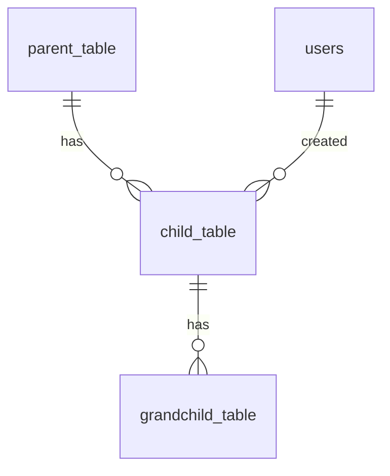
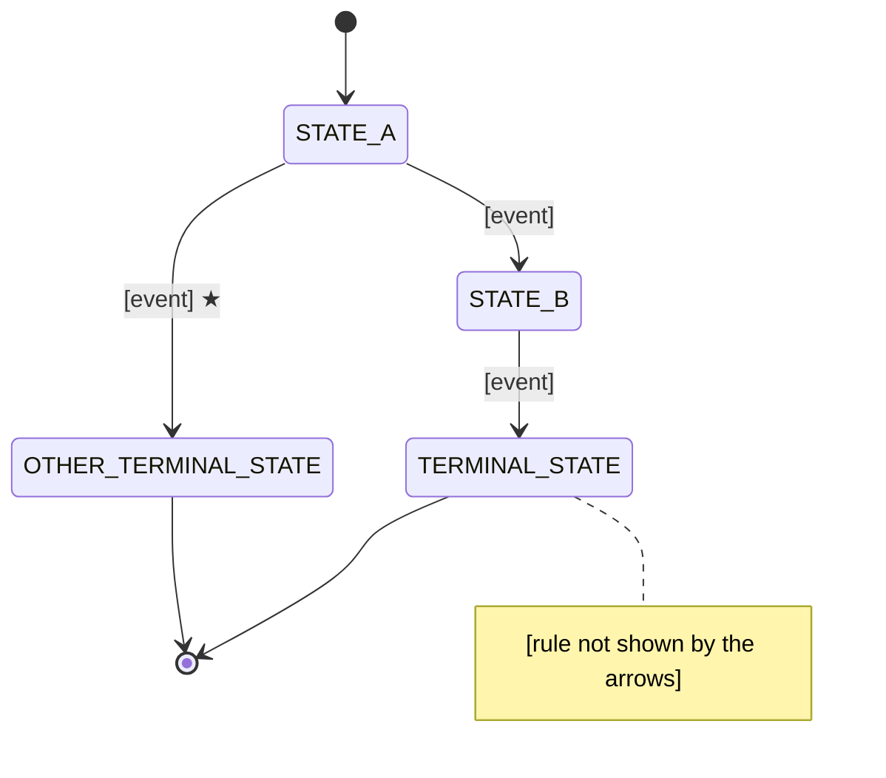

# Data Model Template

Fill this when writing the data model doc. Delete any section that doesn't apply.

````markdown
# [Feature Name] -- Data Model

> [One or two sentences: what this data model supports, and links to the related brief, ticket, or mockup.]

## Decisions

- [e.g. One `order_items` row per line item; no separate line-item details table.]
- [e.g. Use a database enum for status; no lookup table until tenants need custom values.]

## Hierarchy

```text
[parent_table]
└── [child_table]                (NEW)
    ├── [grandchild_table]       (NEW)
    └── [existing_table]         (CHANGED: adds [column])
```

## ER Diagram



## Lifecycle

Include when a status column has more than two states or rows move between states through jobs, retries, or user actions. Mark new transitions with `★`.



- ★ [New transition and the layer that owns it.]

---

## New Tables

### [table_name]

[One sentence: what one row represents.]

| Column | Type | Constraints |
|--------|------|-------------|
| id | uuid (v7) | PK |
| [tenantId] | uuid | FK → [tenants].id (cascade), NOT NULL |
| [parentId] | uuid | FK → [parent_table].id (cascade), NOT NULL |
| [name] | varchar(255) | NOT NULL |
| [status] | [table_status] enum | NOT NULL, default [VALUE] |
| [config] | jsonb ([TypeName]) | nullable |
| createdAt | timestamptz | NOT NULL, default now |
| createdBy | uuid | FK → users.id, nullable |
| updatedAt | timestamptz | NOT NULL, default now, auto-update |

| Constraint / Index | Kind | Definition | Purpose |
|--------------------|------|------------|---------|
| [table_name]_[slug]_unique | unique | `([tenantId], [slug])` | [One slug per tenant] |
| [table_name]_[parent]_ownership_fk | FK (cascade) | `([parentId], [tenantId])` → [parent_table] `(id, [tenantId])` | [Same tenant as the parent] |
| [table_name]_[parent]_order_idx | index | `([parentId], [order])` | [List children in order] |
| [table_name]_[rule]_check | check | `[expression]` | [Invariant] |

**Notes:** [Rules not obvious from the columns, e.g. "Rows are created lazily when the section is first opened."]

---

### [table_name]

[One sentence: what one row represents.]

| Column | Type | Constraints |
|--------|------|-------------|
| id | uuid (v7) | PK |
| ... | ... | ... |

| Constraint / Index | Kind | Definition | Purpose |
|--------------------|------|------------|---------|
| ... | ... | ... | ... |

---

## Changes to Existing Tables

### [existing_table]

| Change | Column | Details |
|--------|--------|---------|
| Add | [columnName] | [type, nullability, default, purpose] |
| Change | [columnName] | [from → to] |
| Remove | [columnName] | [why; when it's safe after backfill] |

| Change | Constraint / Index | Kind | Definition | Purpose |
|--------|--------------------|------|------------|---------|
| Add | [table_name]_[rule]_unique | unique | `([columns])` | [why] |
| Remove | [old_constraint_name] | index | `([columns])` | [why] |

---

## Enums and Value Sets

**[table_status] enum:** `[VALUE_A]` | `[VALUE_B]` | `[VALUE_C]`

## JSON Types

```typescript
// [table_name].[column]: JSON column typed as [TypeName]
interface [TypeName] {
  [key]: string;
  [optionalKey]?: number;
}
```

---

## Access Control Summary

| Table | Policy |
|-------|--------|
| [table_name] | Tenant-isolated ([RLS policy or app-layer check]) |
| [child_table] | Via `[parentId]` → [parent_table] |

---

## Migration and Backfill

1. Generate the migration with the project's migration tool; do not hand-edit generated SQL.
2. [How existing rows reach the new shape, e.g. "Copy `locationText` into `location` for rows where it is set."]
3. [What happens to old columns and when they're removed.]
````
